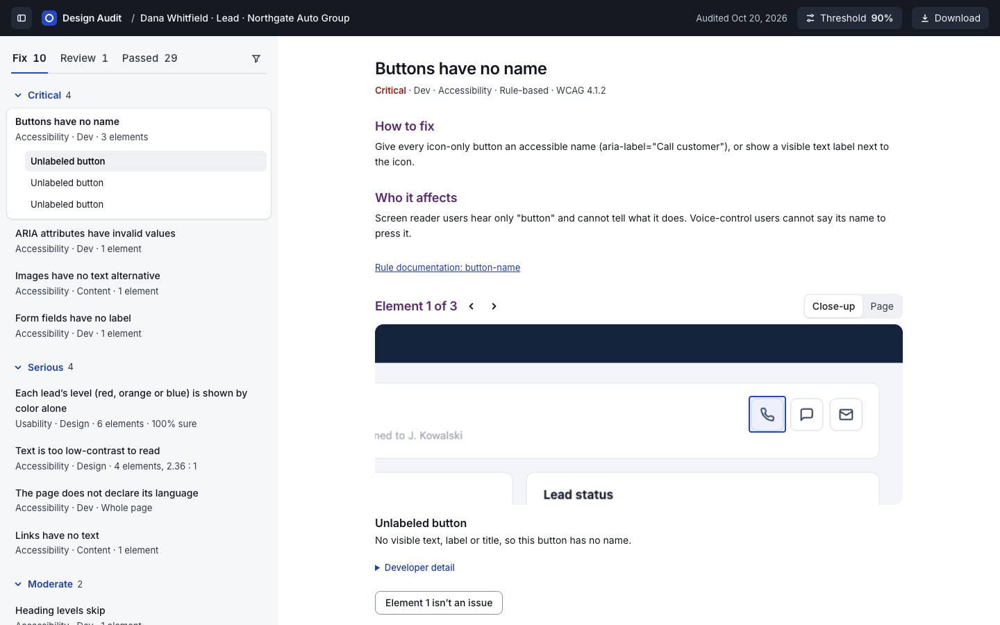

# Design Audit

An accessibility and usability audit that runs inside Claude Code. Point it
at a page you're building and it tells you what to fix, in plain language,
and fixes it in your code if you want, one approved change at a time.
Where a rule can decide, it uses the rule. Where it can't, several Claude
judges answer separately, and the confidence is how many agree.

[Live demo report](https://ashdzick.github.io/design-audit/), on a made-up
car dealership's lead view with problems planted on purpose.

## Quick start

You need [Claude Code](https://claude.com/claude-code), Node 22 or newer,
and Google Chrome. The audit drives your installed Chrome, so there's
nothing extra to download.

```bash
git clone https://github.com/ashdzick/design-audit.git
cd design-audit
npm install
claude
```

Then ask Claude:

```text
Audit fixtures/lead-view/index.html
```

or a page of your own:

```text
Audit http://localhost:3000/settings and tell me what to fix first.
```

or have it fix what it finds:

```text
Audit http://localhost:3000/settings and fix what you can.
```

Claude asks for a review threshold and how many judges to use (defaults 90%
and 3), runs the audit, has the judges look at what rules can't decide, and
opens the report. Only audit pages you own or are allowed to test.

The skill lives in this repo, so start Claude Code in the `design-audit`
folder, as above, and point it at any page, including your own app running
on localhost. Installing it once for all your projects is on the list below.



## Who it's for

Anyone who wants help with accessibility and usability in what they build.
It checks the page you're building against
[WCAG 2.2](https://www.w3.org/TR/WCAG22/), the web's accessibility
guidelines, and common usability practices and says how sure it is about each problem. It doesn't assume you
have a designer to ask.

## How it works

1. Rules. Headless Chrome opens the page and
   [axe-core](https://github.com/dequelabs/axe-core) checks it against
   [WCAG 2.2](https://www.w3.org/TR/WCAG22/) levels A and AA. Each rule-based
   finding names the WCAG criterion it's about and links to the rule's
   documentation. The
   [WCAG quick reference](https://www.w3.org/WAI/WCAG22/quickref/) lets you
   look up any criterion and how to meet it. A rule that fails or passes is certain. One that can't
   decide (text on an image, say) says so.
2. Judgment. Claude takes what rules can't tell, such as color carrying
   meaning on its own, a field whose only label is its placeholder, text on
   images and inside diagrams, and whether low-contrast text is part of a
   picture. Each question goes to several judges (subagents) that can't see
   each other's answers. The confidence is the share that agree, so "2 of 3
   judges" means two of the three agreed.
3. Sorting. You set a review threshold. Findings at or above it go to
   **Fix** (or Passed). Anything below it, and anything a rule couldn't
   decide, goes to **Review** for a person.
4. The report. Each issue says what's wrong, who it affects and how to fix
   it, with a close-up of every element on the page. Judges also suggest
   things, like "Decorative, 3 of 3" for text that's part of a picture, or
   the alt text an image should have.
5. Fixing, if you ask. Claude finds each element in your code and shows the
   change before making it, using what the audit knows: the judges' alt
   text, the measured contrast, the rule's fix. It never hides an element or
   turns off a rule to make a finding go away, and leaves anything in Review
   to you. Then it audits the page again and tells you what's fixed, what's
   still there and anything new.
6. Not an issue. Mark any element "Not an issue" with a reason. The decision
   is saved in your project and remembered on later runs, until that
   element's code changes. A suggestion can pre-pick the reason. You still
   confirm each element.

PDF and CSV downloads are in the report.

## How many judges

Each judgment question goes to the number of judges you pick. They answer
separately, the verdict is what most of them said, and the confidence is the
share that said it. More judges give a finer confidence and cost more, since
each judge is one more run of Claude.

| Judges | Confidence can be | Use it when |
|---|---|---|
| 1 | Always 100% | You want a quick first pass while building and will read every finding yourself. With one judge there's no agreement to measure, so nothing judged goes to Review on its own. |
| 3 (default) | 67% or 100% | Most audits. It's the smallest number that can disagree and still have a majority, so a clear call (3 of 3) and a split one (2 of 3) look different. |
| 5 | 60%, 80% or 100% | Before you share or ship, or on a page with a lot of borderline text (on images, in diagrams). The threshold gets more stops: at 80%, 4 of 5 is enough. |
| 7 to 10 | Finer steps | Rarely needed. Useful for checking the judgment questions themselves. |

Rule-based checks don't use judges. They run once and are either certain or
can't decide.

## How sure is sure enough

The review threshold decides what goes straight to **Fix** (or Passed) and
what goes to **Review** for a person. Claude asks for it before an audit
(default 90%). You can also pass `--threshold 80` on the command line, or
move it in the report with the Threshold button, which shows what moves.

| Threshold | With 3 judges |
|---|---|
| 70 to 100% (default 90%) | Only findings all three judges agree on go to Fix or Passed. A 2 of 3 split goes to Review. |
| 67% or lower | Two of three is enough to go to Fix or Passed, so nothing judged goes to Review. |

Rule-based findings are 100% sure, so the threshold never moves them, and
anything a rule couldn't decide always goes to Review. The questions the
judges answer are written out in `lib/judgment.mjs`, one per check, if you
want to read or change what they're asked.

## What it checks today

| Check | Decided by | What you get |
|---|---|---|
| Text contrast | Rule | The measured ratio against the one required |
| Names for buttons, links, images and fields; page language and title; headings; page regions; ARIA; zoom; touch target size | Rule | Which element, what's wrong, how to fix it |
| Contrast the rule couldn't measure: text on images, gradients and diagrams, symbols, text under other elements | Judges, from 2x close-ups | Readable or not, and how many judges agree |
| Meaning shown by color alone | Judges, from the screenshot | Which marks, and how many judges agree |
| A placeholder as a field's only label | Judges, from the screenshot and the field's code | Which fields, and how many judges agree |
| Low-contrast text that's part of a picture | Judges, from wide close-ups | A suggested "Decorative" for you to confirm |
| Images with no alt text | Rule finds them; judges suggest the fix | `alt=""` if decorative, or a drafted description |

The rule-based checks are axe-core's WCAG 2.2 A/AA and best-practice rules.

## On a live site

The W3C's [Before and After Demonstration](https://www.w3.org/WAI/demos/bad/)
is a site built with accessibility problems on purpose, next to a fixed
version. We audited both home pages with 3 judges.

| | Before | After |
|---|---|---|
| To fix | 8 issues | 3 issues |
| Images with no alt text | 33. Judges: 27 are borders and spacers, so `alt=""` (3 of 3). 4 are navigation buttons drawn as images, needing "Home", "News", "Tickets" and "Survey" (3 of 3). 2 are photos that need a description (2 of 3). | None |
| Text the rule couldn't measure | 2 pieces on images, both readable (3 of 3) | 25 pieces on images or under other elements, all readable (3 of 3) |
| Left for a person to review | 0 | 0 |

The fixed page still fails three rules newer than the demo itself: page
regions, a main region, and the WCAG 2.2 touch target size.

On the made-up lead view, a fresh Claude Code session asked to "fix what you
can" changed 20 elements across all 10 issues (names for icon buttons, a
label for the search box, words next to the colored dots, darker gray text,
and more). The second audit, judges included, found all 20 fixed and nothing
new. It left the one item in Review for a person.

## What it can't do yet

- One page per run, and not pages behind a sign-in.
- Judgment checks need Claude Code. Run on its own
  (`node scripts/audit.mjs <page>`), the tool does the rule-based checks and
  writes the judgment questions to the report folder for later.
- Keyboard flows and how a screen reader actually sounds still need a
  person.

## Where it's going

- Audit while building. Run on its own after Claude changes a screen, and
  stay quiet about what you've already decided.
- Usability checks for internal apps, such as forms, tables, destructive
  actions and empty states.
- Whole apps. Several pages per run, with an overview.

## Without Claude Code

```bash
node scripts/audit.mjs <url-or-path> [--threshold 90] [--runs 3] [--open]
```

Writes `report.html`, `findings.json` and `screenshot.png` to
`reports/<page>-<time>/`. `--open` serves the report locally so "Not an
issue" can save. Judgment briefs wait in `judge/` inside the report folder.
Once judges have answered them, `node scripts/add-judgments.mjs <report
folder>` merges them in. After a round of fixes, `node scripts/compare-audits.mjs
<before folder> <after folder>` lists what's fixed, what's still there and
anything new.

## FAQ

<details>
<summary>Does it send my page anywhere?</summary>

The rule-based checks run on your computer. When the judges run, Claude sees
the page's screenshot, close-ups of the elements in question, and short
snippets of their code, the same as anything else you share in Claude Code,
under your account's data policy. Reports stay in `reports/` on your machine.

</details>

<details>
<summary>Do I need Claude Code?</summary>

For the judgment checks, yes, for now. Without it, the tool runs the
rule-based checks and writes the judgment questions to the report folder.
See [Without Claude Code](#without-claude-code).

</details>

<details>
<summary>Can it audit pages behind a sign-in?</summary>

Not yet. Pages on your local dev server work as long as they don't need a
login.

</details>

<details>
<summary>Does it change my code?</summary>

Only if you ask, and only with your approval for each change. Afterwards it
audits the page again to check. If you audit one of the demo pages in
`fixtures/`, it copies the page to `try/` and fixes the copy, since the
originals are test data.

</details>

<details>
<summary>How long does an audit take?</summary>

The rule-based checks take a few seconds per page. Judges run side by side,
and each takes from a few seconds to a minute or so, depending on how many
elements it looks at.

</details>

<details>
<summary>It says it can't find Chrome.</summary>

The audit drives your installed Google Chrome rather than downloading a
browser. Install Chrome and run it again.

</details>

<details>
<summary>Does it replace testing with people?</summary>

No. It catches a lot, but keyboard use, how a screen reader actually sounds
and whether real people can finish a task still need people.

</details>

## Contributing

Issues and pull requests are welcome. If the audit gets something wrong on a
page, an issue with the page (or a small copy of it) and what you expected
helps the most.

## Tests

```bash
npm test
```

Unit tests cover ranking, triage, dismissals, merging judges' answers and
comparing an audit before and after fixes.
Real runs on the fixture pages check that every planted rule-based issue is
caught, that the judgment checks find what they should, and that nothing
leaks to the judges. The report also audits itself and must have nothing to
fix.

The fixture pages in `fixtures/` are made up: a car dealership's lead view,
lead list and test-drive form, each with issues planted on purpose and
listed in `planted.json`. Numbers like (D40) in code comments refer to a
design decision log that isn't published.

## License

MIT
